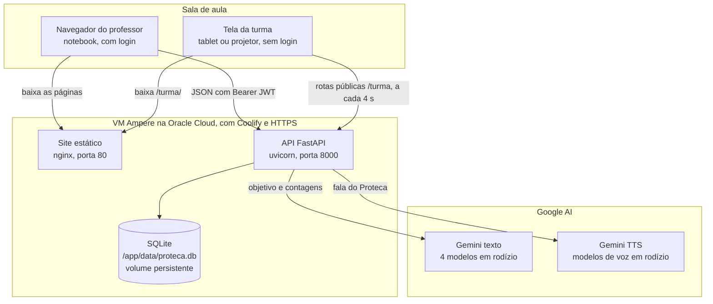
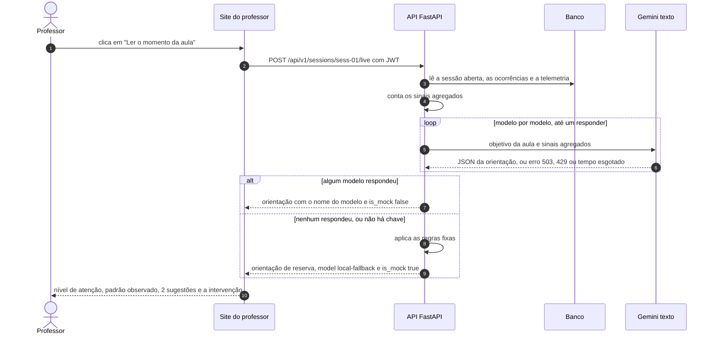
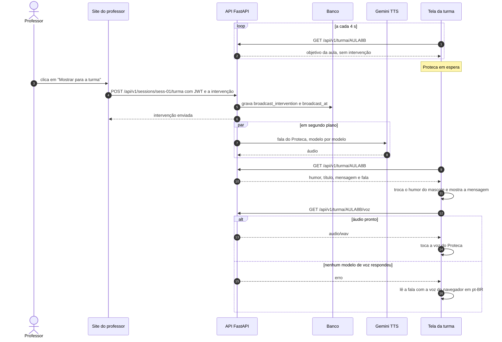
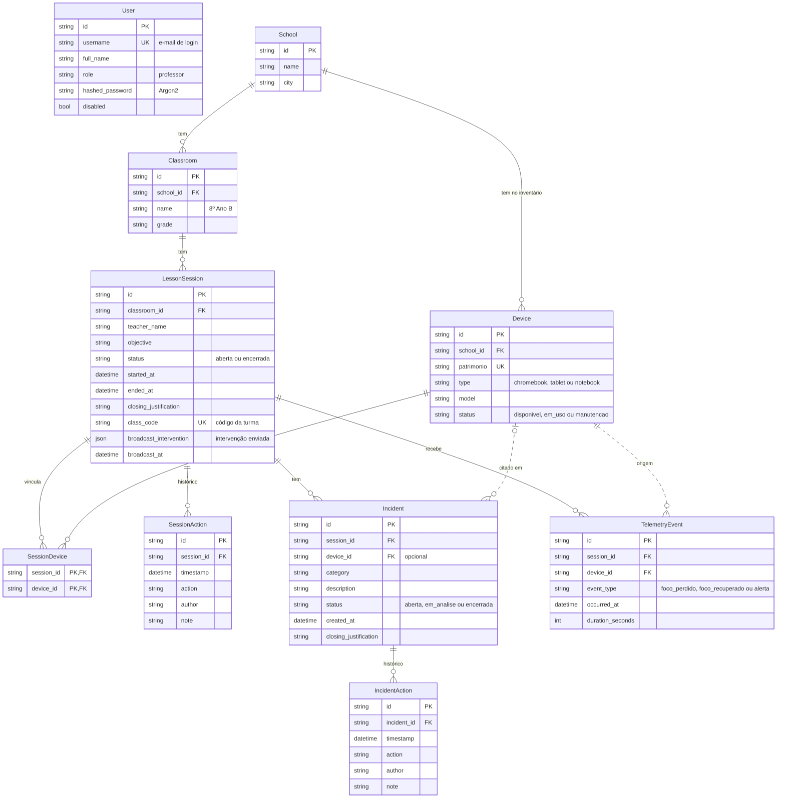
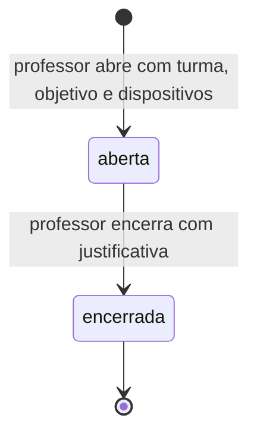
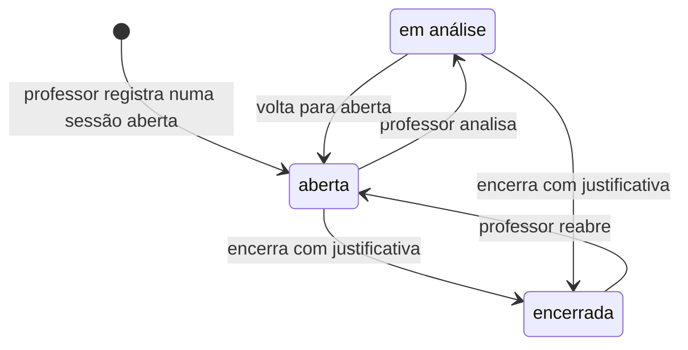
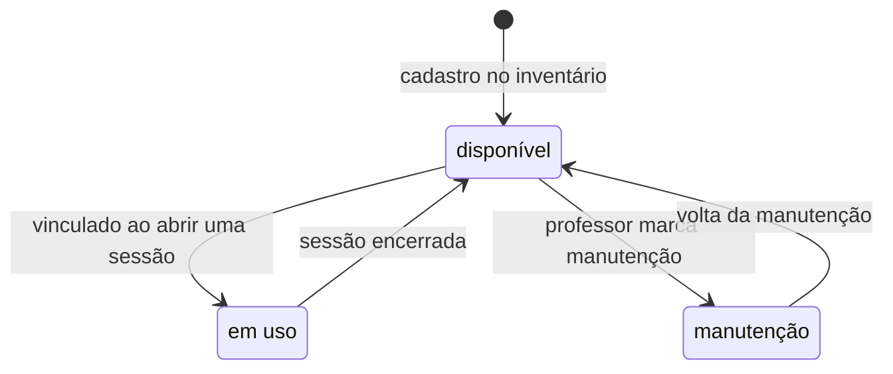

# Arquitetura do Proteca

Atualizado em 24/11/2026. Os termos seguem o `GLOSSARY.md`. O motivo de cada escolha está em `docs/adr/`.

O que ainda está na branch `sprint-4/persistencia-e-turma` (banco SQLite e tela da turma) aparece marcado com **(Sprint 4)**.

| Parte | Tecnologia | Onde roda |
|---|---|---|
| Site do professor e tela da turma | Next.js 15 exportado como estático, TypeScript, Tailwind | nginx num container do Coolify |
| API | Python 3.12, FastAPI, Pydantic v2, SQLModel | container do Coolify, porta 8000 |
| Banco **(Sprint 4)** | SQLite, arquivo `proteca.db` | volume persistente do Coolify em `/app/data` |
| Login | JWT emitido pela API, senha com Argon2 | API |
| IA de texto e de voz | Gemini, chamado só pela API | Google |

Produção:

- Site: https://app.163.176.54.212.sslip.io
- API: https://api.163.176.54.212.sslip.io (Swagger em `/docs`, saúde em `/api/v1/health`)

## 1. Implantação

Os dois containers rodam na mesma VM, atrás do proxy HTTPS do Coolify (Let's Encrypt em domínios `sslip.io`). O navegador baixa o site do nginx e chama a API direto. Só a API fala com o Gemini, então a chave nunca chega ao navegador.

## 2. Proteca Live

O site manda só o id da sessão. A API monta os sinais a partir do banco e tenta os modelos na ordem de `GEMINI_MODEL` e `GEMINI_FALLBACK_MODELS`. Se todos falham, a orientação de reserva sai das regras de `_fallback` em `services/ai_guidance.py`.

| Ordem | Modelo de texto | Modelo de voz (TTS) |
|---|---|---|
| 1 | `gemini-3.5-flash-lite` | `gemini-3.8-flash-tts` |
| 2 | `gemini-3.1-flash-lite` | `gemini-3.8-flash-lite-tts` |
| 3 | `gemini-3.8-flash` | `gemini-3.1-flash-tts-preview` |
| 4 | `gemini-3.6-flash` | `gemini-2.5-flash-preview-tts` |

Os `lite` vêm primeiro porque a cota gratuita deles é de 500 requisições por dia, contra 20 dos `flash`.

O que vai para o Gemini de texto e o que fica na API:

| Vai | Não vai |
|---|---|
| Objetivo da aula | Descrição das ocorrências |
| Dispositivos ativos, eventos de foco perdido, alertas de segurança | Número de patrimônio ou id de dispositivo |
| Ocorrências abertas, total e por categoria | Nome do professor |
| Minutos desde o início da sessão | Qualquer dado de estudante (não existe no sistema) |

## 3. Mostrar para a turma (Sprint 4)

O professor decide o que a turma vê. A API grava a intervenção na sessão e já pede o áudio em segundo plano, para a tela não ficar esperando a síntese. A tela da turma só manda o código: ela pergunta a cada 4 s se há intervenção nova e, quando há, troca o humor do mascote (acolhimento, curiosidade ou guardião) e toca a voz.

O navegador do tablet só toca áudio depois de um toque na tela. Por isso a tela da turma tem o botão "Ativar o som", que precisa ser tocado uma vez.

| Rota | Quem chama | Login | O que faz |
|---|---|---|---|
| `POST /api/v1/sessions/{id}/turma` | site do professor | JWT | grava a intervenção enviada e dispara a síntese da voz |
| `DELETE /api/v1/sessions/{id}/turma` | site do professor | JWT | tira a intervenção da tela da turma |
| `GET /api/v1/turma/{codigo}` | tela da turma | não | devolve o objetivo da aula e a intervenção enviada, se houver |
| `GET /api/v1/turma/{codigo}/voz` | tela da turma | não | devolve o WAV da fala do Proteca |

As rotas públicas não recebem nada além do código e não usam cookies. Elas não devolvem dispositivos, ocorrências nem nome de professor (ADR 0004).

## 4. Banco (Sprint 4)

A escola é a raiz. A sessão liga a turma aos dispositivos pela tabela `SessionDevice`, porque o mesmo dispositivo passa por várias sessões no mesmo dia. `SessionAction` e `IncidentAction` guardam quem fez o quê e quando. `User` só guarda quem faz login. O diagrama mostra os campos principais, e nenhuma tabela tem campo de estudante.

## 5. Estados

### Sessão de aula

Com a sessão aberta funcionam o Live, o registro de ocorrência e o código da turma. Ao encerrar, a API libera os dispositivos que estavam em uso, e o código da turma deixa de abrir. Um Live ou uma ocorrência em sessão encerrada recebe 409.

### Ocorrência

Cada mudança entra no histórico da ocorrência. Encerrar sem justificativa dá 422, e uma transição fora do diagrama dá 409. A tabela de transições está em `INCIDENT_TRANSITIONS`, no repositório.

### Dispositivo

O estado `em uso` só muda pela sessão: pedir `em_uso` pela rota de status dá 422, e mandar para manutenção um dispositivo em uso dá 409. Abrir uma sessão com um dispositivo que não está disponível também dá 409.

## 6. Onde fica cada regra

| Regra | Arquivo |
|---|---|
| Rotas, uma por recurso | `backend/app/routers/` |
| Contratos de entrada e saída | `backend/app/schemas/` |
| Tabelas SQLModel | `backend/app/models/` |
| Transições de sessão, ocorrência e dispositivo | `backend/app/repositories/` |
| Sinais agregados do Live | `backend/app/services/session_signals.py` |
| Rodízio de modelos e orientação de reserva | `backend/app/services/ai_guidance.py` |
| Voz do Proteca em rodízio | `backend/app/services/voice.py` |
| JWT e senha | `backend/app/auth/` |
| Variáveis de ambiente | `backend/app/core/config.py` |
| Cliente HTTP, token e volta ao login no 401 | `frontend/src/services/api.ts` |
| Proteção das páginas com login | `frontend/src/components/AuthGuard.tsx` |
